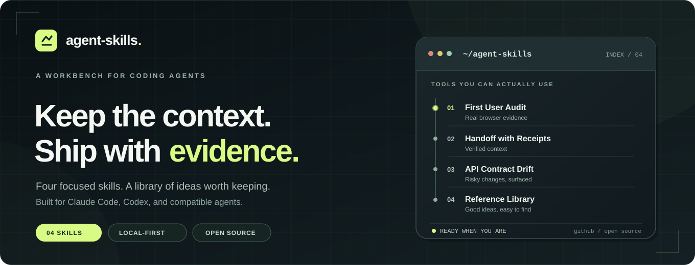

<p align="center">
  
</p>

<p align="center">
  <a href="#see-a-result-in-30-seconds">See the demo</a> ·
  <a href="#choose-your-workflow">Browse skills</a> ·
  <a href="#the-reference-library">Saved inspiration</a> ·
  <a href="#proof-over-promises">Our standards</a>
</p>

<p align="center">
  <a href="https://github.com/BarganConstantin/agent-skills/actions/workflows/validate.yml"></a>
  <a href="https://github.com/BarganConstantin/agent-skills/actions/workflows/public-install.yml"></a>
  <a href="LICENSE"></a>
</p>

**Small, useful tools for coding agents.** Keep work context, review API changes, test a first-time user's journey, and recall good ideas. Built for Claude Code, Codex, and other compatible agents.

## See a result in 30 seconds

No AI agent, account or server needed. Our **API Contract Drift** script compares two synthetic OpenAPI snapshots with three planted problems:

```bash
git clone https://github.com/BarganConstantin/agent-skills.git
cd agent-skills
python skills/api-contract-drift/scripts/compare_openapi.py \
  --before examples/api-contract-drift/before.json \
  --after examples/api-contract-drift/after.json
```

<details>
<summary><b>Expected report — three potential client breaks</b></summary>

```text
Potential client breaks: 3; coverage warnings: 0
- anonymous_access_removed at GET /catalog
- required_parameter at POST /orders
- required_property at POST /orders
```

This is a **controlled fixture**, not a result from a real API or proof of complete compatibility. [Inspect the example](examples/api-contract-drift/README.md).

</details>

## Choose your workflow

| Skill | Why you'd use it | Needs |
| :-- | :-- | :-- |
| **01 / [First User Audit](skills/first-user-audit/SKILL.md)** | Follow a real browser journey and record reproducible onboarding friction. | Safe local app + browser MCP |
| **02 / [Handoff with Receipts](skills/handoff-with-receipts/SKILL.md)** | Continue work in a new session with verified Git state and open questions. | Git/Python optional |
| **03 / [API Contract Drift](skills/api-contract-drift/SKILL.md)** | Spot potentially breaking OpenAPI changes before release. | Offline Python 3.10+ |
| **04 / [Reference Library](skills/reference-library/SKILL.md)** | Search saved GitHub inspirations by task and bookmark new discoveries. | Offline Python 3.10+ |

### One skill. One command.

With Node.js 22.20+ and npm, **pick one** of these alternatives:

```bash
npx skills add BarganConstantin/agent-skills --skill first-user-audit
npx skills add BarganConstantin/agent-skills --skill handoff-with-receipts
npx skills add BarganConstantin/agent-skills --skill api-contract-drift
npx skills add BarganConstantin/agent-skills --skill reference-library
```

Installing a skill copies instructions; it doesn't run an agent or connect tools. To inspect without installing:

```bash
npx skills use BarganConstantin/agent-skills --skill reference-library
```

## The reference library

**Find the good ideas when you need them.** The [organized library](docs/library.md) groups verified project references by **UI/UX · Backend/API · Code Review · Testing/QA · Agent Workflows** and links to every original repository.

<a href="docs/library.md"></a>

```bash
python skills/reference-library/scripts/library.py categories
python skills/reference-library/scripts/library.py browse backend
python skills/reference-library/scripts/library.py search "landing page design" --category ui-ux
```

Or tell your agent: *“Use reference-library. What have I saved that can help this UI task? Show source links and reasons.”*

Our [curated catalog](skills/reference-library/references/catalog.json) stores **9 unique** original links, categories, tags, use cases and review dates, **not third-party code**. Installed copies do not sync automatically to other projects. [Curation rules](skills/reference-library/references/curation.md).

## Try browser-based first-user QA

> Use first-user-audit in QUICK CHECK mode on my safe local app. Verify browser prerequisites, follow one new visitor to a defined first-success event, capture actual evidence, and do not edit my app. Mark the remaining three personas NOT RUN.

Quick Check covers **1/4 personas**; a full isolated audit requires independent subagents. Never target production or use real customer data. No app ready? Use the [synthetic practice lab](docs/practice-lab.md). Read the [full walkthrough](docs/first-user-audit.md), [browser setup](skills/first-user-audit/references/browser-setup.md), and [Claude Code / Codex first-run guide](docs/first-five-testers.md). The lab is **not** an independent agent evaluation.

## Proof over promises

Our [v0.2.0 controlled browser demo](https://github.com/BarganConstantin/agent-skills/tree/v0.2.0/examples/first-user-demo) compares a deliberately broken fixture with a separately prepared corrected one. It does **not** demonstrate autonomous repairs or real-world conversion. [Evaluation details](docs/evaluation.md).

CI checks Python tests and [installation from the public GitHub repo](.github/workflows/public-install.yml) with telemetry disabled. Passing CI does not prove human adoption or perfect agent results.

**Tried a skill?** [Share first-run feedback](https://github.com/BarganConstantin/agent-skills/issues/new?template=first-run-feedback.yml) without private data.

[Contributing](CONTRIBUTING.md) · [Security](SECURITY.md) · [Growth research](docs/growth-research.md) · [MIT](LICENSE)

If the toolkit helped you, a GitHub star helps other developers find it.
