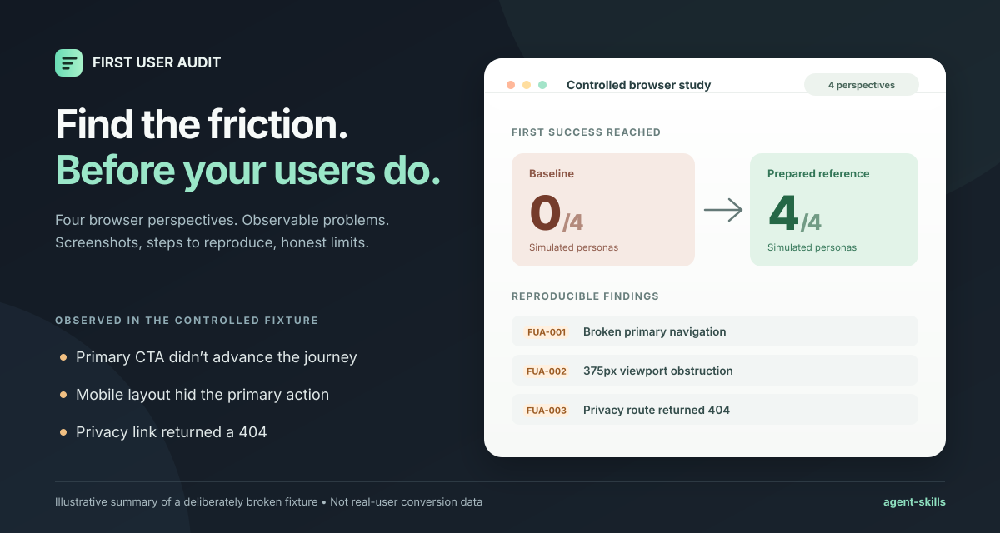

# Agent Skills for Developers

**Two focused open-source workflows for coding agents.** Install what you need; no account, subscription, or private app access required just to inspect a skill.

| Skill | When to use it | Setup |
| --- | --- | --- |
| **[Handoff with Receipts](skills/handoff-with-receipts/SKILL.md)** | Switching between Claude Code / Codex, ending a long session, or handing work to another engineer; capture actual Git state, verified claims and the next safe action | No MCP; optional Git + Python 3.10+ |
| **[First User Audit](skills/first-user-audit/SKILL.md)** | Check whether a first-time visitor can reach actual value in a local web app with a real browser and reproducible evidence | Browser MCP + safe local/isolated preview |

## Handoff with Receipts — new

A handoff is only useful if the next agent knows **what actually happened**. This skill separates *verified observations* from *old claims* and *unknowns*, takes an optional **path-redacted Git snapshot**, and helps reconcile branch/worktree changes before work resumes.

```bash
npx skills add BarganConstantin/agent-skills --skill handoff-with-receipts
```

Then prompt your coding agent:

```text
Use handoff-with-receipts to prepare a resumable checkpoint of this task.
Capture current Git branch, HEAD and dirty counts if Git is available.
Separate VERIFIED command output from REPORTED history and UNKNOWNs.
Keep my scope restrictions; redact secrets. Tell the next agent the
first safe action. Do not change my code, commit, or push.
```

**No Git repo?** Still make an honest note with Git state marked `NOT CHECKED`. See the [handoff template](skills/handoff-with-receipts/assets/handoff-template.md) and [evidence limits / source inspiration](skills/handoff-with-receipts/references/evidence-boundaries.md).

---

## First User Audit

**Find where first-time visitors get stuck — before they give up.**

An open-source [Agent Skill](https://agentskills.io/specification) for browser-based first-user QA. It follows a new visitor from your landing page to the first useful result, captures observable friction with screenshots and reproduction steps, and produces a reviewable report.

[](https://github.com/BarganConstantin/agent-skills/actions/workflows/validate.yml)
[](LICENSE)



*Illustration of a **controlled fixture** from [v0.2.0](https://github.com/BarganConstantin/agent-skills/releases/tag/v0.2.0), not a product screenshot, real-user conversion study, or proof of autonomous bug fixing. [Inspect the original evidence](https://github.com/BarganConstantin/agent-skills/tree/v0.2.0/examples/first-user-demo).*

### Try Quick Check

Run in your **web application's project** (Node.js 22.20+ and npm):

```bash
npx skills add BarganConstantin/agent-skills --skill first-user-audit
```

**Want to preview the instructions before installing?** The current [Skills CLI](https://github.com/vercel-labs/skills/blob/main/docs/commands.md) also supports:

```bash
npx skills use BarganConstantin/agent-skills --skill first-user-audit
```

This prints a skill-use prompt without adding an installed skill to your project; it **does not** start an agent or a browser audit. The CI [installer smoke test](.github/workflows/verify-cli-install.yml) verifies both discovery and this preview command with telemetry disabled.

With the skill installed, give your coding agent this request:

```text
Use first-user-audit in QUICK CHECK mode on my local app.
Identify the first useful user outcome; inspect browser and safety
prerequisites, then follow one new visitor's primary journey.
Collect real screenshots and reproduction steps. Do not edit my app.
Report actual results, missing capabilities, and 1/4 persona coverage.
```

**Requirements:** a running localhost or confirmed isolated preview (never production), a connected browser MCP such as [Playwright MCP](skills/first-user-audit/references/browser-setup.md), a fresh/resettable test session, and test-only accounts/integrations if needed. Installing the skill does *not* install a browser connection or sandbox. [Quick Check protocol](skills/first-user-audit/references/quick-check.md).

Quick Check is a single-agent **read-only** first journey. No independent subagents are required. The other three personas are explicitly reported as **not run**.

**Trying this for the first time?** Follow the [Claude Code / Codex setup and first-run guide](docs/first-five-testers.md). If you try it—even if browser setup fails—[share your first-run feedback](https://github.com/BarganConstantin/agent-skills/issues/new?template=first-run-feedback.yml). We’re looking for the first five **independent** attempts to improve onboarding, not asking for artificial installations or stars.

#### No web app ready? Try the practice lab

The repository contains a **localhost-only sample app with deliberately seeded onboarding problems**. You can use it to exercise the real browser workflow without creating accounts or supplying customer data.

```bash
git clone https://github.com/BarganConstantin/agent-skills.git
cd agent-skills
python evals/fixtures/activation_lab.py --variant seeded --port 8765
```

Then follow the [five-minute practice guide](docs/practice-lab.md) to install the skill, connect your agent's browser MCP and run a read-only Quick Check. The lab is a **public training fixture**, not an independent evaluation or claim of AI performance.

### Need a deeper audit?

| Workflow | Coverage | App changes? |
| --- | --- | --- |
| **Quick Check** | One first-impression journey; 1/4 personas | No |
| **Audit Only** (default when not specified) | Four isolated perspectives: impatient, skeptic, mobile, breaker | No |
| **Audit + Fix + Verify** (explicit opt-in) | Four baseline perspectives, bounded technical fixes, four fresh verification passes | Limited and permitted only |

The full workflow checks the obvious CTA, pricing/terms/privacy clarity, mobile layout at 375 CSS pixels, and invalid inputs/retries. Independent subagents are required for genuine isolation; without them, the full audit needs explicit approval for an honestly labeled lower-isolation approximation.

All workflows **stop** when a safe preview or working browser automation is unavailable. A successful skill installation is not proof that the browser audit can run.

### What gets reported

- **First success:** observable outcome and proof, or a clear reason it wasn't reached.
- **Friction:** exact route, expected vs actual behavior, reproduction steps, screenshots, and stable issue IDs.
- **Coverage and limits:** personas actually run, clicks to success (or `null` when blocked), verified vs unsupported capabilities.
- **Report:** structured JSON, a Markdown summary, and an [optional offline HTML view](skills/first-user-audit/references/html-report.md) with no telemetry or remote dependencies.

Artifacts stay in the **audited application's ignored** `qa/first-users/` directory. Inspect for private data before sharing. Python 3.10+ is needed only for the optional report generators; no Python packages are required for them.

### Evidence, not promises

Our historical [Task Cabin v0.2.0 controlled demonstration](https://github.com/BarganConstantin/agent-skills/tree/v0.2.0/examples/first-user-demo) recorded:

| Observed problem in deliberately defective app | Personas affected |
| --- | --- |
| The main CTA failed to navigate | Impatient + breaker |
| Mobile content pushed the CTA offscreen | Mobile |
| Privacy policy link led to a 404 | Skeptic |

The four baseline simulated personas reached first success **0/4** times; four different runs against a **separately prepared corrected fixture** reached it **4/4** times. These are controlled observations, not independent validation on an unknown app, statistically meaningful conversion measurements, or an autonomous repair benchmark. CI tests validate tooling and fixtures; they don't rerun the full agent study.

[View the historical screenshots and reports](https://github.com/BarganConstantin/agent-skills/tree/v0.2.0/examples/first-user-demo) · [Read the engineering article](https://dev.to/bargan/i-built-an-agent-skill-that-tests-your-app-like-four-first-time-users-180d)

### Scope and contribute

Designed for local or isolated-preview **web apps** before launch or after onboarding changes. **Not** production penetration testing, real-user research, legal review, device touch emulation, or permission to change auth, billing, security, pricing, retention, or external integrations.

We are building an independently reviewable [with-skill vs without-skill evaluation](docs/evaluation.md), with a [local scorer](evals/README.md) and [controlled browser fixture](evals/fixtures/README.md). **No genuine comparative performance improvement has been measured yet.**

Found a reproducible issue or tested Quick Check on your app? [Open a GitHub issue](https://github.com/BarganConstantin/agent-skills/issues) with safely redacted steps. See [CONTRIBUTING.md](CONTRIBUTING.md) and [SECURITY.md](SECURITY.md). If the skill helps you, consider starring this repository to help others discover it.

MIT licensed · [Full skill instructions](skills/first-user-audit/SKILL.md) · [Report schema](skills/first-user-audit/references/report-format.md)
