# Reference Library

**A handpicked shelf of useful developer projects.** Start with the kind of work you're doing—not a wall of links. Every entry leads to its **official source site or repository**, explains *when it helps*, and records a reviewed license. Nothing is copied or installed just by being listed.

*The public gallery and offline explorer are generated from [the canonical catalog](../skills/reference-library/references/catalog.json). After editing the catalog, run `python scripts/render_library.py --write`; CI checks both views for drift. The visuals are static-first, with optional finite animation.*

### Prefer interactive browsing?

Clone the repository, then **open `docs/library-explorer.html` in your web browser** (double-click the file, or use `open` / `xdg-open`). It works offline with no server, package installation or account: search by task, select a category, inspect original source links and clear the filters. [View the generated HTML file](library-explorer.html) — note that GitHub's code viewer displays HTML source rather than running the page. The page contacts no services while filtering; clicking a source link opens its official website or repository.

## Choose by task

| What you need now | Start with | What to check |
|---|---|---|
| A React component system and consistent themes | [Astryx components](https://astryx.atmeta.com/components) or [HeroUI](https://heroui.com/en/docs/react/getting-started/agent-skills) | Framework version, setup, component API and license. Astryx is beta and requires React 19+. |
| Editable component source you maintain in your project | [shadcn/ui components](https://ui.shadcn.com/docs/components) | Local customization, dependencies and upstream update maintenance. |
| Visual examples or a specific component/template | [21st.dev](https://21st.dev/) | Item-specific license, dependencies and platform terms; preview media is separate from code. |
| A stronger visual direction or landing page | [Hallmark](https://github.com/Nutlope/hallmark) or [AI Design Skills](https://github.com/elayadesign/ai-design-skills) | Fit with the existing product and available browser tools. |
| Local distributed services and observability | [Backend / API](#backend--api): Aspire | Whether its app model fits your existing services. |
| Backend agents and orchestration | [Backend / API](#backend--api): Microsoft Agent Framework | Runtime, hosting model and integration requirements. |
| Breaking API changes | [Code Review](#code-review): oasdiff | The actual old/new OpenAPI specifications. |
| Browser testing or reproduction | [Testing / QA](#testing--qa): Playwright MCP or CLI | Browser access and an isolated test environment. |
| A repeatable agent development workflow | [Agent Workflows](#agent-workflows): Superpowers or Spec Kit | Which workflow fits the task and what tools it requires. |

Need an installable skill instead? See the [task guide](choose-by-task.md)
for audit, test cleanup, orientation, Figma design and tutoring.
The sections below contain the full saved notes. Nothing here installs itself.

<p align="center"></p>

<!-- BEGIN GENERATED LIBRARY — edit catalog.json, not this section -->
## Browse by area

[**UI / UX**](#ui--ux) · 7 references
[**Backend / API**](#backend--api) · 3 references
[**Code Review**](#code-review) · 3 references
[**Testing / QA**](#testing--qa) · 3 references
[**Agent Workflows**](#agent-workflows) · 3 references

> **14 unique sources** · 19 category placements. A project may appear in more than one section without being duplicated in the catalog. New unreviewed bookmarks are collected in the Inbox.

## Explore saved projects

### UI / UX

Interfaces, visual systems, motion and meaningful first impressions.

| Original project | Why it's useful | Reach for it when… | License |
| :-- | :-- | :-- | :-- |
| **[Hallmark](https://github.com/Nutlope/hallmark)** | Distinctive interface design, design themes, responsive audits and avoiding generic AI-looking layouts. | Building or reviewing distinctive landing pages, web UI and visual systems; avoiding generic AI-looking layouts and checking responsive quality. | [MIT](https://github.com/Nutlope/hallmark/blob/main/LICENSE) |
| **[AI Design Skills (Elaya)](https://github.com/elayadesign/ai-design-skills)** | Landing-page content and visual systems, plus animation/motion showcase workflows. | Planning a landing page from the audience and conversion goal, choosing a visual system, or producing motion demonstrations of an existing design. | [MIT](https://github.com/elayadesign/ai-design-skills/blob/main/LICENSE) |
| **[HeroUI React skill](https://github.com/heroui-inc/heroui/tree/v3/skills/heroui-react)** | Agent skill for building React UIs with HeroUI v3 components, theming and component docs lookup. | Building React interfaces with HeroUI v3: choosing components, reading their props and examples, and setting up themes and dark mode. | [Apache-2.0](https://github.com/heroui-inc/heroui/blob/v3/skills/heroui-react/LICENSE.txt) |
| **[Astryx](https://astryx.atmeta.com/components)** | Meta’s customizable React design system with composable components, theme tokens, prebuilt CSS and agent-oriented documentation and CLI tooling. | Evaluating a customizable React design system, reusable UI components, themes and documented patterns that people and coding agents can use together. | [MIT](https://github.com/meta/astryx/blob/main/LICENSE) |
| **[21st.dev](https://21st.dev/)** | A marketplace for discovering UI components, themes and templates, with visual references and workflows for coding agents. | Browsing visual references, React component examples, themes and page templates before choosing an approach for a web interface. | [Per-item licenses; platform terms](https://21st.dev/terms) |
| **[shadcn/ui](https://ui.shadcn.com/docs/components)** | Editable UI component source and a distribution workflow for building your own design system, with official examples, theming and registry tooling. | Building a custom component system when you want the editable component source in your own project, with documented primitives and a consistent composition approach. | [MIT](https://github.com/shadcn-ui/ui/blob/main/LICENSE.md) |
| **[DesignBookmark Motion](https://designbookmark.com/motion)** | Live animated UI examples with code and coding-agent handoffs for exploring component interactions. | Choosing a concrete animation or interaction for a UI component and showing a coding agent the intended behavior before implementation. | [Per-item licenses; platform terms](https://designbookmark.com/terms) |

### Backend / API

Services, .NET orchestration, API contracts and agent infrastructure.

| Original project | Why it's useful | Reach for it when… | License |
| :-- | :-- | :-- | :-- |
| **[Aspire](https://github.com/microsoft/aspire)** | Code-first app composition, service integrations, observability and local development for distributed apps. | Working on .NET or mixed-language distributed systems; debugging services, telemetry and local app orchestration. | [MIT](https://github.com/microsoft/aspire/blob/main/LICENSE.TXT) |
| **[Microsoft Agent Framework](https://github.com/microsoft/agent-framework)** | Build, orchestrate and host AI agents in .NET and Python, with reusable workflow patterns. | Building backend agents, durable workflows, MCP integrations or multi-agent orchestration in .NET or Python. | [MIT](https://github.com/microsoft/agent-framework/blob/main/LICENSE) |
| **[oasdiff](https://github.com/oasdiff/oasdiff)** | Compare OpenAPI specifications and surface breaking changes in local tooling or CI. | Reviewing backend API changes, migrating consumers, auditing schema changes and adding compatibility checks to pull requests. | [Apache-2.0](https://github.com/oasdiff/oasdiff/blob/main/LICENSE) |

### Code Review

Spot regressions, interrogate assumptions and review changes before shipping.

| Original project | Why it's useful | Reach for it when… | License |
| :-- | :-- | :-- | :-- |
| **[oasdiff](https://github.com/oasdiff/oasdiff)** | Compare OpenAPI specifications and surface breaking changes in local tooling or CI. | Reviewing backend API changes, migrating consumers, auditing schema changes and adding compatibility checks to pull requests. | [Apache-2.0](https://github.com/oasdiff/oasdiff/blob/main/LICENSE) |
| **[Superpowers](https://github.com/obra/superpowers)** | Composable agent workflows for planning, test-driven work, debugging and verification. | Reviewing plans, implementing changes with evidence, debugging systematically, or creating a repeatable test-first agent workflow. | [MIT](https://github.com/obra/superpowers/blob/main/LICENSE) |
| **[Spec Kit](https://github.com/github/spec-kit)** | Structured specification, feature planning, bug investigation and decision reviews for coding agents. | Starting a complex feature, reviewing ambiguous requirements or creating a traceable plan and decision record before implementation. | [MIT](https://github.com/github/spec-kit/blob/main/LICENSE) |

### Testing / QA

Real-browser evidence, reproducible checks and test-first workflows.

| Original project | Why it's useful | Reach for it when… | License |
| :-- | :-- | :-- | :-- |
| **[Playwright MCP](https://github.com/microsoft/playwright-mcp)** | Give agents real browser navigation and interaction through a structured MCP interface. | An agent needs to inspect a safe local app, reproduce a user journey, or gather actual interactive browser evidence. | [Apache-2.0](https://github.com/microsoft/playwright-mcp/blob/main/LICENSE) |
| **[Playwright CLI](https://github.com/microsoft/playwright-cli)** | Run browser actions and inspect pages from a CLI; useful with coding-agent skill workflows. | An agent or developer prefers concise shell-driven browser checks, screenshots, selector inspection or test reproduction. | [Apache-2.0](https://github.com/microsoft/playwright-cli/blob/main/LICENSE) |
| **[Superpowers](https://github.com/obra/superpowers)** | Composable agent workflows for planning, test-driven work, debugging and verification. | Reviewing plans, implementing changes with evidence, debugging systematically, or creating a repeatable test-first agent workflow. | [MIT](https://github.com/obra/superpowers/blob/main/LICENSE) |

### Agent Workflows

Structured planning, tool use, context and multi-agent engineering.

| Original project | Why it's useful | Reach for it when… | License |
| :-- | :-- | :-- | :-- |
| **[Microsoft Agent Framework](https://github.com/microsoft/agent-framework)** | Build, orchestrate and host AI agents in .NET and Python, with reusable workflow patterns. | Building backend agents, durable workflows, MCP integrations or multi-agent orchestration in .NET or Python. | [MIT](https://github.com/microsoft/agent-framework/blob/main/LICENSE) |
| **[Superpowers](https://github.com/obra/superpowers)** | Composable agent workflows for planning, test-driven work, debugging and verification. | Reviewing plans, implementing changes with evidence, debugging systematically, or creating a repeatable test-first agent workflow. | [MIT](https://github.com/obra/superpowers/blob/main/LICENSE) |
| **[Spec Kit](https://github.com/github/spec-kit)** | Structured specification, feature planning, bug investigation and decision reviews for coding agents. | Starting a complex feature, reviewing ambiguous requirements or creating a traceable plan and decision record before implementation. | [MIT](https://github.com/github/spec-kit/blob/main/LICENSE) |
<!-- END GENERATED LIBRARY -->

## Find exactly what you need

From a clone of this repository, or from your installed `reference-library` skill directory (adjust the path):

```bash
python skills/reference-library/scripts/library.py categories
python skills/reference-library/scripts/library.py browse ui-ux
python skills/reference-library/scripts/library.py browse backend
python skills/reference-library/scripts/library.py search "oauth contract review" --category review
python skills/reference-library/scripts/library.py search "browser automation" --category testing
python skills/reference-library/scripts/library.py show hallmark
```

Or tell a coding agent where the installed skill is available: **“Use reference-library. I'm implementing a .NET API. Show me relevant saved sources from Backend and Review, why each helps, and the original links. Don't install anything.”**

## Save a new discovery

If you tell us to save a new link, the canonical home is [`skills/reference-library/references/catalog.json`](../skills/reference-library/references/catalog.json) **in this repository**. Check ownership and the license, add a short purpose, choose category tags, and preserve the original URL.

To preview an *unverified* local bookmark without saving:

```bash
python skills/reference-library/scripts/library.py add --id example-tool \
  --name "Example Tool" --url https://github.com/example/tool \
  --tags api,backend --categories backend,review \
  --use-when "Check versioned API changes"
```

Add `--write` only when intentionally saving into a *local* catalog. To keep it permanently in this public collection, the canonical catalog must be updated in an approved branch and merged. Installed copies do **not** sync automatically. If you're unsure which category applies, omit `--categories` and it enters the catalog’s **Inbox** for review; unverified new entries are not endorsements.

## Source and safety standards

- **Review dates are per entry:** inspect the catalog or explorer for each source’s `reviewed_at` date. Notes describe the source at that date; behavior and licenses may change.
- **Licenses differ by source and sometimes by item.** 21st.dev is a marketplace governed by platform terms and individual licenses, not a blanket MIT collection. Links require no copying, but substantial code/assets reuse may require preserving notices and other license conditions. Image and font assets can have separate licenses.
- **Reference-only:** bookmarking doesn't install a skill, run its scripts, grant tool permissions, or prove effectiveness.
- **Use with intent:** compare the task with the original upstream README, check prerequisites and safety, and choose whether to learn from an idea or adopt a dependency.
- **Do not invent usage evidence:** GitHub stars are not stored in the catalog and a saved project is not automatically recommended or loaded by every agent client.

[Back to the skills](../README.md) · [See catalog JSON](../skills/reference-library/references/catalog.json) · [Read curation rules](../skills/reference-library/references/curation.md)
