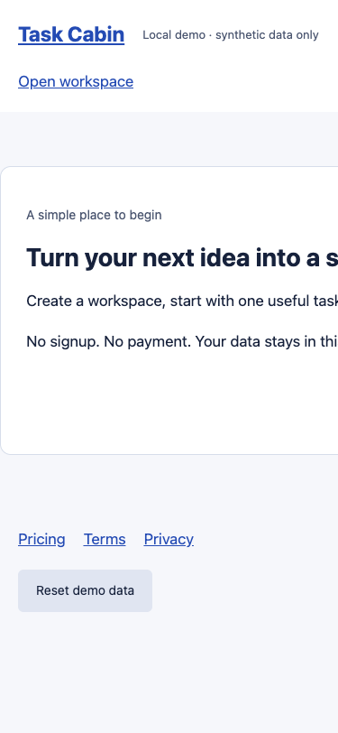
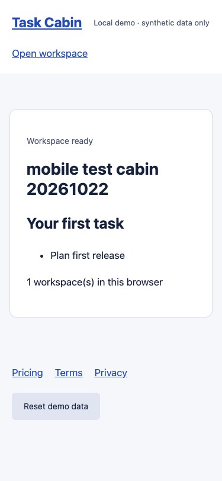

# Task Cabin: a local First User Audit demonstration

This deliberately flawed fixture lets you inspect a complete first-user journey without connecting a customer product. It has no authentication, payment, email, analytics, or external API. Workspace data lives only in browser localStorage. The Python server binds to `127.0.0.1` and serves only the fixture routes.

## Recorded example: 2026-10-22

Eight real browser runs used the published v0.1.0 instructions: four baseline personas, then four fresh verification contexts, all sequential. See the [generated report](report.md), [reviewed JSON records](reports/), and [provenance and issue mapping](study.json). Raw tool transcripts and MCP session state are not published.

| Persona | Baseline | Fixed | Clicks to fixed success |
| --- | --- | --- | ---: |
| Impatient | Stopped at main CTA | Reached first success | 2 |
| Skeptic | Privacy navigation returned 404 | Reached first success | 5 |
| Mobile | Content overflowed 375px viewport; CTA offscreen | Reached first success | 2 |
| Breaker | Stopped at main CTA | Reached first success | 6 |

The baseline breaker did **not** reach invalid-input testing. A separate deterministic smoke check reproduced blank-name acceptance. The verification breaker tested empty/whitespace names, retry, back navigation and double-submit; one workspace remained. Its instruction clarified that expected validation feedback is not an implementation defect. This is not a matched before/after invalid-input comparison.

The coordinator created new agent contexts without inherited conversation history. Individual tester reports retain their own inability to attest to that orchestration (`independent_subagent: unverified` in most reports); the coordinator records provenance separately. Contexts shared a filesystem and were instructed not to read other runs, which is not an OS-enforced isolation guarantee.

Reviewed viewport screenshots were copied unchanged and contain only synthetic fixture content. Nine evidence files cover the four baseline obstacles, four success states, and validation feedback. For example:

| Baseline at 375 CSS px | Fixed at 375 CSS px |
| --- | --- |
|  |  |

[Invalid-input feedback](evidence/after-breaker-validation.png) and [successful double-submit check](evidence/after-breaker-success.png) are also available. Issues were consolidated after testing: the two CTA observations share FUA-001; mobile overflow is FUA-002; the broken Privacy link is FUA-003. This mapping is explicit in `study.json`; no semantic deduplication by the reporter is claimed.

To regenerate the committed example summary from the repository root:

```bash
python skills/first-user-audit/scripts/summarize.py --root examples/first-user-demo/reports --strict --verify-evidence --output examples/first-user-demo/report.md
```

## Run it

From this repository root, with Python 3.10+:

```bash
python examples/first-user-demo/server.py --variant baseline
```

Open <http://127.0.0.1:4179/>. The first-success event is:

> Create one named test workspace and see its dashboard containing the starter task.

Success requires both the visible dashboard with **Plan first release** and exactly one valid named workspace in `task-cabin-demo-v1` localStorage. Clicking the CTA alone is insufficient.

Reset with **Reset demo data**, or discard the isolated browser context. The server stores no application data. Use only synthetic workspace names. Storage is scoped to the origin; every persona must get a fresh context, not just a fresh tab.

## Install and invoke

In a clean project with Node.js 22.20+ and npm:

```bash
npx skills add BarganConstantin/agent-skills --skill first-user-audit --agent claude-code
# Or select Codex:
npx skills add BarganConstantin/agent-skills --skill first-user-audit --agent codex
```

Tell the agent:

```text
Use first-user-audit on http://127.0.0.1:4179/.
This is the synthetic Task Cabin fixture. Define first success from its code.
Use four fresh persona contexts sequentially and reset browser state between them.
Save evidence under qa/first-users/, fix only bounded technical defects,
and verify with four new testers who have not seen the findings.
Disclose unsupported capabilities and stop at missing prerequisites.
```

Installation supplies instructions, not browser access or subagent support. To reproduce the published-instructions evaluation, install the tagged source `https://github.com/BarganConstantin/agent-skills/tree/v0.1.0` instead of the moving default branch. To use the reporter with evidence-file checks, install v0.2.0 or use the checked-out script.

## Browser connection used for this example

Start the pinned Microsoft Playwright MCP server in another terminal at the repository root:

```bash
npx -y @playwright/mcp@0.0.83 --isolated --headless --browser chrome \
  --port 8931 --host 127.0.0.1 --allowed-origins http://127.0.0.1:4179 \
  --output-dir qa/first-users/evidence --image-responses omit --no-webmcp
```

A compatible MCP client can connect to `http://localhost:8931/mcp`. Install Chrome if the server reports it missing. The server's hostname check expects `localhost` for the MCP URL even though it binds to loopback. Origin filtering is not a security boundary; inspect redirects and retain the skill's safety rules.

If your runner can execute commands but cannot dynamically register MCP tools, the optional `mcp_client.py` adapter sends real MCP HTTP calls. It does not implement personas or choose actions:

```bash
python examples/first-user-demo/mcp_client.py --session qa/first-users/sessions/example.json tools/list
python examples/first-user-demo/mcp_client.py --session qa/first-users/sessions/example.json browser_navigate '{"url":"http://127.0.0.1:4179/"}'
python examples/first-user-demo/mcp_client.py --session qa/first-users/sessions/example.json browser_close '{}'
```

Use a new session-file path per persona, close the browser after each, and execute sessions sequentially. Inspect `tools/list` for current schemas. Raw snapshots, MCP session files, tool transcripts and screenshots stay under the ignored `qa/first-users/`. The demo contains synthetic data, but that does not make arbitrary audit artifacts safe to publish.

## Reproduce the remediation

The fixture preserves baseline and fixed variants for repeatability. The baseline intentionally has four technical defects: the main CTA only changes a fragment; a privacy navigation link goes to a missing route; the main content is wider than a narrow screen; blank workspace names are accepted. The fixed variant corrects those links/layout/validation and guards repeated form submission. Policy text is identical in both variants.

After completing the baseline, stop the demo server with Ctrl+C, then run:

```bash
python examples/first-user-demo/server.py --variant fixed
```

Use the same origin, viewport sizes and first-success criterion, with fresh browser storage and four new subagent contexts. Do not give verification agents this defect inventory or the baseline reports. Compare observations only after verification.

With the v0.2.0 reporter, validate eight collected reports and their evidence files:

```bash
python skills/first-user-audit/scripts/summarize.py --root qa/first-users --strict --verify-evidence
```

`--strict` checks coverage and consistency; `--verify-evidence` checks file presence and containment. Neither proves screenshot authenticity, agent independence or actual browser use. Human review and tool transcripts remain necessary.

## Scope

The fixture demonstrates instruction following and evidence collection against known, intentionally introduced failures. It is not a customer-product case study, a benchmark, a security boundary, or a measured conversion improvement. Narrow viewport testing does not establish touch/device compatibility. Slow-3G behavior requires supported tooling and must be reported as not tested when unavailable.

## Deterministic smoke checks

With the MCP server connected, run `python examples/first-user-demo/browser_check.py --variant baseline` against the baseline server, then the same command with `--variant fixed` against the fixed server. This separately checks the intentional failure states and fixed layout, navigation, invalid input, successful creation and reset. It is a scripted regression check, not another set of independent personas. CI repeats it against both variants on Linux; it does not rerun the agent study.
